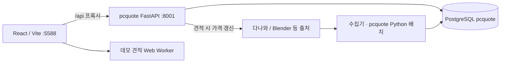

# Dr.Robot 아키텍처

최종 갱신: 2026-11-06

## 구성과 데이터 흐름



2026-11-06부터 서버는 하나다. 별도 프로젝트 `../pcquote/backend`의 FastAPI 서버가 화면 API, 추천 엔진, 견적 저장을 모두 맡는다. buildmate에는 화면(React)과 수집 파이프라인(Node 배치)이 남는다. 웹 개발 서버는 vite.config.js 설정으로 /api 요청을 127.0.0.1:8001에 넘긴다. `npm run build`로 만든 `dist/`가 있으면 8001 서버가 화면도 직접 내보낸다(`http://127.0.0.1:8001/`).

## 주요 모듈

| 모듈 | 책임 |
| --- | --- |
| src/main.jsx | 상담·견적·이력·설정 화면과 API 연결 |
| src/use-catalog.jsx | 카탈로그·가격 이력·수집 현황 조회와 주기 갱신 |
| src/engine.mjs | 요구 해석, 후보 탐색, 호환성·예산 검사, 견적 선택. 서버 추천은 pcquote 엔진이 맡고, 이 엔진은 데모 모드(`?demo=1`) Web Worker와 화면 쪽 요구 해석에 쓴다 |
| src/recommend-worker.mjs | UI 스레드 밖에서 견적 계산 실행 |
| src/alternatives.mjs | 교체 후보와 교체 가능 조건 계산 |
| src/data-policy.mjs | 가격·벤치마크 신선도 및 사용 가능 여부 |
| src/consultation-session.mjs | 임시 상담의 서버 저장·복원과 이전 |
| backend/document-files.mjs | 수집 JSON 문서의 SQLite 저장 어댑터 |
| pipeline/store.mjs | 제품 사실·가격·벤치마크 관측·작업·검수 큐 |
| pipeline/run.mjs / expand.mjs / publish.mjs | 수집·발견·스냅샷 발행 |
| pipeline/daily.mjs / scheduler.mjs | 한국시간 자정 작업과 중복 실행 제어 |
| pipeline/lock.mjs | 수집 lock 파일(pid 기록)과 종료된 소유자의 lock 회수 |

## 저장 구조

| 저장소 | 주요 내용 |
| --- | --- |
| PostgreSQL `pcquote` | 서버 운영 데이터: parts(엔진 사양 + 화면용 원본 raw), price_history, saved_quotes, app_settings, documents(catalog-meta 등), llm_usage, price_reviews. 구조는 pcquote `docs/architecture.md` |
| backend/data/buildmate.db | 2026-11-06 이전 운영 데이터(견적·설정·상담 상태·LLM 사용량). `pcquote/backend/scripts/migrate_buildmate_db.py`로 PostgreSQL에 옮겼고 서버는 더 쓰지 않는다 |
| backend/data/pipeline.db | product_facts, price_observations, benchmark_observations, pipeline_jobs, review_queue |
| backend/data/documents.db | documents: 경로별 JSON 문서, source_assets: 벤치마크 원본 |

documents 어댑터는 프로젝트 경로의 JSON을 DB에서 먼저 조회한다. DB에 없으면 기존 파일을 읽어 JSON을 검증한 뒤 최초 가져오기를 수행한다. 이후 갱신은 DB에 기록한다. 파일 경로를 문서 키로 사용하므로 저장소 이동 시 경로 재매핑이 필요하다. 프로젝트 외부 경로는 별도 DB 위치를 사용하며 테스트 환경도 이에 해당한다.

서버는 documents.db를 읽기 전용으로 연다. 발행된 카탈로그 문서(`public/data/catalog.json`)의 updated_at이 바뀌면 PostgreSQL로 다시 가져오고, 수집 현황·발견 상태·가격 이력 문서는 요청 때 읽는다. 이전 Node 서버는 documents.db를 우선 조회하고 기존 스냅샷 테이블·파일을 호환 경로로 사용했다. DB를 도입했다고 모든 파일이 제거된 것은 아니다. 원본 파일은 복구용으로 유지하고, 로그·프로세스 잠금은 파일 시스템을 사용한다. Python 벤치마크 파서는 DB의 등록부를 임시 파일로 전달받고 결과를 DB에 저장한다.

## 주요 API

| 경로 | 역할 |
| --- | --- |
| GET /api/health | 모드(live)·저장소(postgresql)·LLM 설정·엔진(pcquote) |
| GET /api/catalog | 카탈로그(화면 형식 원본) |
| GET /api/pipeline/status | 수집·검수 현황(documents.db) + 수동 수집 실행 여부 |
| GET /api/discovery/status | 발견 진행 상태 |
| GET /api/prices/snapshot | 가격 이력 스냅샷 |
| POST /api/pipeline/run | `node pipeline/run.mjs --expand` 수동 실행 |
| POST /api/requirements | 요구사항 구조화(OpenRouter, 없으면 규칙) |
| POST /api/answer | 근거 기반 질문 답변(금액·FPS 검사, 실패 시 카탈로그 답변) |
| POST /api/recommend/fresh | pcquote 추천 → 선택 부품 다나와 가격 갱신 → 재추천 |
| POST /api/quotes/evaluate | 부품 교체 후 검사·성능 재계산 |
| POST /api/quotes/alternatives | 호환 대체 후보 id 목록 |
| GET / POST /api/quotes | 이력 조회·확정 견적 저장(pcquote 규칙으로 재검증, 예산 상한) |
| DELETE /api/quotes/:id | 이력 삭제 |
| POST /api/quotes/import | 기존 브라우저 이력 가져오기 |
| GET / PUT /api/settings | 매장 설정 |
| GET / PUT /api/state/:name | 테마 및 live/demo 상담 임시 상태 |

이전 Node 서버의 `POST /api/recommend`(내장 엔진), `/api/prices/history`, `/api/knowledge*`는 화면이 쓰지 않아 옮기지 않았다.

## 견적 계산

현재 실제 모드의 신규·재생성은 서버 가격 갱신 API를 사용하고, 데모 모드 계산은 Web Worker를 사용한다. 소규모 카탈로그는 기존 탐색을 사용하고, 1,000개 초과 카탈로그는 중간 후보를 제한한다. 저가 후보와 CPU·GPU 성능별 후보를 유지하면서 호환성·예산 검사를 적용한다. 균형안과 강화안 구분을 위한 선택 규칙이 있으며 전수 탐색의 최적성 보장은 없다.

UI에서 계산을 분리하는 것과 계산 자체가 종료되는 것은 별개다. 대규모 데이터 결과, 시간, 실패·취소 경로는 별도로 검증한다. 서버 API의 계산은 Node 이벤트 루프에서 실행되므로 별도 성능·동시 요청 검토가 필요하다.

### 서버 견적 (2026-11-06~)

모든 견적은 pcquote 엔진이 고른다. 데모 모드(`?demo=1`)는 서버 없이 브라우저의 내장 엔진을 쓴다.

1. buildmate 데이터 정책(필수 사양, NVMe 전용, 벤치마크 3표본·45일, 품절)을 통과하지 못하는 부품은 처음부터 후보에서 뺀다. 가격 24시간 만료는 빼는 이유가 아니라 갱신 대상이다. 정책은 pcquote `policy.py`로 옮겼고, 실제 부품 6,829개에서 JS 판정과 같은 결과를 확인했다.
2. 3안에서 가격이 24시간보다 오래된 부품만 다나와에서 갱신하고 다시 추천한다(최대 6회). 기존 수집 규칙(robots.txt, 출처당 2초, 허용 호스트, 재시도, 8MB)을 지킨다. 직전 가격 대비 30% 넘게 바뀐 가격은 `price_reviews`에 남기고 그 부품을 뺀다. 갱신에 실패한 부품도 뺀다.
3. 균형형 → 최적 균형안, 성능 우선형 → 성능 강화안, 가성비형 → 절약안. 외장 GPU 없음은 `g0`, OS는 `o0`/`o1`. 상한(`budgetCap`)은 예산 그대로다. 기본 최소 사양으로 예산 안 조합이 없으면 엔진이 사양을 단계적으로 낮추고(`Result.relaxed`), 응답 `notice`로 화면 견적 메시지에 안내한다. BIOS 업데이트가 필요한 칩셋 조합은 통과로 보되 검사 이름에 "(출고 전 확인)"을 붙이고 보드 `biosPreparation`에 표시한다.
4. 견적 저장(`POST /api/quotes`)은 부품 존재·데이터 정책·가격 일치·카탈로그 버전·pcquote 호환 규칙·예산 상한을 다시 검사한다.

실행: `npm run server`(= `cd ../pcquote/backend && uv run uvicorn pcquote.main:app --host 127.0.0.1 --port 8001`). PostgreSQL `pcquote` DB가 필요하다. OpenRouter 키는 `pcquote/backend/.env`, 없으면 buildmate `.env`에서 읽는다. 예산 미지정 요청은 422로 예산을 묻는다.

## 운영과 확인할 제약

- DB 파일은 Git에 포함하지 않는다. 다른 환경에서는 데이터 이전 또는 수집을 실행해야 한다.
- WAL 모드 SQLite 백업은 실행 중인 DB 파일 하나의 단순 복사로 대체하지 않는다. 일관된 백업·복원 시험이 필요하다.
- 브라우저의 기존 값은 해당 브라우저가 접속해야 가져올 수 있다.
- 임시 상담과 테마의 서버 상태는 현재 사용자별로 분리되지 않는다.
- DB 저장 실패 알림·임시 상태의 종료 직전 저장·경로 이동 복구는 후속 검증 대상이다.

## 변경 기록

- 2026-11-06: 현재 세 DB 구조, JSON 호환 어댑터, Worker 계산, API 연결과 알려진 제약을 문서화.
- 2026-11-06: 비교표의 기본 select를 ProductRow의 공용 대체 부품 팝업으로 통합했다. 제조사 탭은 후보의 brand/manufacturer 값을 우선 사용하며 없으면 제품명 첫 단어로 대체한다. DB·API 구조 변경은 없다.
- 2026-11-06: 경고 배너 표시 상태는 App의 dismissedWarning으로 관리한다. 선택안·검사 결과·관측 시각으로 경고 키를 구성하며 DB·API 저장과는 독립적이다.
- 2026-11-06: src/storage-policy.mjs의 storageIssue를 수집 등록, usablePart, 교체 후보, validateBuild에서 공유한다. 기존 DB 카탈로그는 잘못된/미확인 SSD에 검수 표시를 남기고 버전을 갱신했다. 제품 카테고리 breadcrumb만으로 검증을 우회할 수 없다.
- 2026-11-06: product-ontology.mjs는 제품 사실·관계를 생성한다. knowledge-store.mjs가 buildmate.db의 knowledge_products/facts/relations/meta로 카탈로그 버전별 원자적 동기화를 수행한다. GET /api/knowledge 및 /api/knowledge/products/:id로 조회한다. compatibility.mjs는 엔진·교체·발행이 공유하는 검증 구현이다. 기존 board.bios는 이전 지원 목록으로 유지하며 명시적 cpuSupport 조건이 있으면 우선 적용한다.
- 2026-11-06: workload-evidence.mjs가 용도별 대체 지수와 정확한 구성 실측을 분리한다. knowledge_measurements 테이블과 GET/POST /api/knowledge/measurements가 담당자 검수 자료를 보관한다. 카탈로그의 해당 CPU에 실측 구성을 연결해 Worker에도 전달한다. 실측 모드는 performanceMode=measured, workload, measurementContext(softwareVersion/settings/unit/direction)를 지정하며 일치하는 전체 구성만 탐색한다. 실제 운영 DB에는 테스트용 수치를 넣지 않는다.
- 2026-11-06: proposal-objectives.mjs는 검증된 후보에서 세 안을 선택하고 selection 메타데이터를 생성한다. 현재 구현은 전역 최적화 솔버가 아니라 기존 소규모 탐색/대규모 제한 탐색을 분리한 구조다. compatibilityDependencies를 공통화해 부분 탐색과 완성 검증의 규칙 출처를 맞춘다. UI는 performanceBasis의 대체 지수 표시와 한계를 사용한다.

### 조건부 CPU 지원 입력 예

```json
{
  "cpuSupport": [{
    "cpuId": "대상 CPU 식별자",
    "boardRevision": "제조사 보드 리비전",
    "biosVersions": ["지원이 확인된 정확한 BIOS 버전"],
    "evidence": {"sourceUrl": "https://제조사/지원목록", "observedAt": "ISO 관측 시각"}
  }],
  "revision": "실제 보드 리비전",
  "installedBios": "실제 설치 BIOS 버전"
}
```

BIOS 버전 문자열의 대소 관계를 제조사 공통 규칙으로 추정하지 않는다. 입력한 정확한 버전 목록을 사용한다. 조건부 관계를 모든 CPU·보드 조합의 무조건 호환 간선으로 확장하지 않는다. JSON의 조건은 knowledge_relations.conditions에 보존한다.

### 실측 입력 및 추천

검수된 실측은 POST /api/knowledge/measurements로 등록한다. profile, workload, configuration(모든 슬롯의 실제 제품 ID), softwareVersion, settings, gaming의 resolution, value, unit, direction, sourceUrl, observedAt, reviewed=true, reviewedBy, reviewedAt가 필요하다. API는 형식·구성·검수 기록을 검사하지만 웹 원문 진위를 자동 확인하는 기능은 없다. 등록 담당자가 원문과 측정 조건을 검수해야 한다. 단위가 다른 값끼리 비교하지 않도록 measurementContext가 일치하는 자료만 사용한다. seconds는 낮을수록 좋은 값으로 처리한다.

실측 모드는 API 요청에서 명시적으로 선택한다. 현재 상담 화면은 기본 대체 지수 모드를 사용하며, 실측 조건 선택 전용 UI는 아직 없다. 실제 운영 DB의 실측 자료가 0건이므로 미측정 용도를 측정한 것으로 표현하지 않는다.
- 2026-11-06: scripts/compare-recommendation-basis.mjs는 운영 DB 스냅샷을 읽어 유형 검증 전후의 후보 조건과 네 용도 결합 추천 결과를 reports/에 기록한다. 그래프 테이블 순회 기반의 별도 추천 엔진이나 과거 엔진 전체의 A/B 비교는 아니며 현재 속성/규칙 검증과 Blender 순위 평가의 역할을 비교한다.
- 2026-11-06: storageRecommendationIssue를 제품 분류(storageIssue)와 분리했다. usablePart·대체 후보·validateBuild가 공통 추천 정책을 적용한다. SATA 판단이 NVMe 표기보다 우선하며 M.2라는 폼팩터만으로 NVMe라고 추정하지 않는다.
- 2026-11-06: budget-policy.mjs가 null/undefined 예산을 무상한으로 처리하고 검증·표시·상한 계산을 공유한다. Infinity는 계산 내부에서만 사용하고 저장 요청·요구사항에는 null을 사용한다. LLM 결과의 예산은 사용자 텍스트에서 추출한 금액으로 보정하고 프런트 입력란의 명시 값이 우선한다. proposal-objectives는 무상한 모드에서 고성능 후보를 우선 선택하며 선택 메타데이터에 budgetMode를 남긴다.
- 2026-11-06: storage-policy의 최소 용량과 캐시/서버 인터페이스 배제 규칙을 자동 후보·최종 검증에 연결했다. 온톨로지 v2에서 StorageCache 유형을 도입했다. 예산 없는 4K 입력→생성→DB 발행→제한 없음 표시의 UI/API 회귀 테스트를 추가했다.
- 2026-11-06: budgetSource(text/manual/unlimited/unspecified)를 기록해 예산의 출처를 구분한다. 재생성 시 출처가 없는 과거 요구에서 사용자 텍스트·입력란에도 예산이 없으면 임의 기본예산을 제거한다.
- 2026-11-06: cooling-type.mjs를 UI와 다나와 사양 파서가 공유한다. parseSpecs가 coolingType을 추출하며 scripts/enrich-cooling-types.mjs는 기존 캐시를 재파싱해 카탈로그와 pipeline.db의 제품 사실에 유형·근거를 추가한다. 가격·관측 시각은 갱신하지 않는다. 카탈로그 버전은 분류 변경 시 갱신한다. ProductRow의 coolingFilter는 쿨러에만 적용한다.
- 2026-11-06: pipeline/popularity.mjs는 인기상품순 활성 탭과 일반 상품 목록의 aria-label 인기순위 값을 함께 확인한다. 광고 영역과 개별 번들 popularRank(상품군 내부 순위)는 카테고리 순위로 사용하지 않는다. src/popularity.mjs는 순위 유효성·48시간 신선도와 구성 비교를 공유한다. 구성은 확인된 부품 수를 우선하고 그 수가 같으면 log(1+rank)의 합이 작은 쪽을 우선한다. 이는 판매량이 아닌 명시된 상품군 순위의 집계 정책이다.
- 2026-11-06: pipeline:popularity 명령이 공개 목록을 재확인해 카탈로그·제품 등록부·pipeline.db 제품 사실에 근거를 기록한다. 일일 확장 수집도 같은 파서를 사용한다. 날짜는 순위를 실제 확인한 시각이며 가격 관측 시각을 변경하지 않는다. 순위는 popularity 속성 및 지식 facts에 저장된다. 기존 후보 축약·지배 후보 제거 시에도 더 인기 있는 제품을 값이 비싸다는 이유만으로 삭제하지 않도록 했다.

- 2026-11-06: 실제 DB 검증에서 성능 상위 95% 필터가 순위 있는 쿨러를 예산 밖으로 밀어내는 경우를 확인해, 순위 근거가 있는 후보에서는 해당 필터를 적용하지 않도록 했다. 예산·용도 최소 사양·호환성 검사는 유지한다.
- 2026-11-06: proposal-objectives의 upgrades에서 gaming일 때 CPU/GPU 성능 향상을 선행 검사한다. 실측 모드에서는 CPU/GPU 변경과 동일 조건 실측 향상을 함께 요구한다. 인기순은 이 자격 조건을 통과한 후보에만 적용한다.
- 2026-11-06: proposal-objectives는 모든 예산 지정 균형안에95% 성능 구간을 적용하고 그 안에서 인기·비용을 비교한다. 강화안은 성능, 절약안은 성능/가격을 인기보다 먼저 비교한다. 무예산4K의 GPU/CPU 지수 우선 규칙도 인기보다 앞선다. rankingPolicy=performance-first-popularity-within-tier 및 performanceRetention을 기록한다. 같은 날짜 이전의 popularity-first 정책과 최고 등급 예약 규칙은 폐기했다.
- 2026-11-06: selectProposals는 예산 지정 gaming에서 enhanced가 null일 때 후보 균형안을 성능순으로 검사해 upgrades 관계가 성립하는 쌍을 공동 선택한다. used 집합을 재설정해 중복을 방지하고 선택 결과에 jointlySelected를 기록한다. 공동 선택에서는 performanceRetention=null로 두어95% 보장을 주장하지 않는다. 절약안은 조정된 균형안을 기준으로 계산한다.
- 2026-11-06: build-warnings.mjs가 데이터 문제 사유와 경고 제목을 분리한다. 가격/성능 만료는 dataIssue로, 실제 검사 상태는 warningHeading으로 표현한다. scripts/refresh-current-quote-prices.mjs는 현재 상담 구성(없으면 c1/b1)의 가격을 직접 재수집하고 정상 관측만 DB에 반영한다. 가격 이상치는 기존 검수 큐를 유지한다. 제조사 확인 근거: https://www.msi.com/Motherboard/PRO-B650M-A-WIFI/Specification (AM5·Ryzen7000 지원). 설치 BIOS 버전을 확인한 것으로 확대 해석하지 않는다.
- 2026-11-06: POST /api/recommend/fresh와 backend/refresh-prices.mjs를 추가했다. 현재 실제 모드 UI의 createRecommendations는 이 경로로 후보 가격을 재조회하고 받은 catalogVersion을 견적에 보존한 뒤 카탈로그를 갱신한다. 데모는 기존 Worker 계산 경로를 유지한다. 기존 /api/recommend는 순수 계산 경로로 유지한다. 선택 후보는 용도·최소 공간·제품 형식·벤치마크 유효성·제조사 지원 목록을 고려한 제한된 후보군이다. PipelineStore의 가격 이상치 검수와 SourceClient의 원문·요청 간격 정책을 사용한다.
- 2026-11-06: gaming-cpu-policy.mjs의 isAmdX3d를 가격 재조회·제한 탐색·강화안 선택에서 공유한다. 자동 가격 갱신은 등록된 보드 지원 목록과 맞는 X3D CPU도 별도로 조회한다. proposal-objectives는 X3D 선호 전환을 별도 upgrades 사유로 기록하고 강화안에서 우선한다. 측정 모드에는 선호에 의한 점수 하향 예외를 적용하지 않는다.
- 2026-11-06: expansion.lock·pipeline.lock·collection-worker.lock은 pipeline/lock.mjs의 acquireLock으로 소유 pid를 기록한다. daily·collect-all의 대기 루프는 파일 존재가 아니라 lockHeld(소유 pid 생존, pid 없는 파일은 작성 후 1분 이내)로 판단해, 비정상 종료가 남긴 lock 때문에 자정 갱신이 3시간 대기 후 실패하는 일을 막는다.
- 2026-11-06: refresh-prices.mjs의 plannedStaleParts는 만료(stale) 가격을 현재로 가정한 임시 카탈로그로 recommend를 실행해 실제로 선택될 만료 부품만 반환한다. refreshPrices는 이를 최대 3회 재계획하며 갱신하고, 갱신에 실패한 부품은 다시 고르지 않는다. 임시 카탈로그에서도 구성이 불가능할 때만 기존 refreshCandidates 휴리스틱을 사용한다. POST /api/recommend/fresh는 settings(조립비·제외 브랜드)를 함께 전달한다.
- 2026-11-06: selectProposals의 공동 선택은 게임 전용 조건을 없애고 강화안 또는 절약안이 비면 실행한다. 성능순 균형안 후보 중 강화안(upgrades 1개 이상)과 더 저렴한 절약안이 함께 성립하는 첫 후보를 균형안으로 삼는다. pickSaving은 예산 90% 상한을 우선하고 없으면 균형안 합계 미만으로 다시 고른다.
- 2026-11-06: src/question-answer.mjs가 질문 판별(isQuestion), CPU·GPU 모델 토큰(modelTokens/modelKey), 카탈로그 근거 답변(answerQuestion)을 담당한다. 질문 답변은 클라이언트에서 처리하며 API를 호출하지 않는다. main.jsx는 견적을 만든 assistant 메시지(quote 표시)까지의 대화, 견적 결과, 이후 대화 순으로 렌더링한다. parseRequirement는 models를 반환하고 recommend는 카탈로그에 해당 모델이 있는 CPU·GPU 풀을 그 모델로 제한한다. engine.mjs는 detectProfile을 공개하고 main.jsx는 용도가 바뀌면 이전 요청 문장과 예산 없이 새 요청으로 처리한다. selectProposals의 공동 선택은 예산 없는 요청에도 적용한다.
- 2026-11-06: npm run server는 .env를 읽는다(--env-file-if-exists). OpenRouter 호출은 reasoning을 끄고, 결과를 스키마 검증한 뒤 src/engine.mjs의 mergeInterpretation으로 병합한다. 문장 규칙이 찾은 용도·예산·해상도·옵션이 우선하며 LLM은 규칙이 못 찾은 용도와 확인 질문(예산 질문 제외)만 보탠다.
- 2026-11-06: LLM 하네스. backend/llm.mjs가 OpenRouter 호출(모델 대체, reasoning 비활성, JSON 파싱, 사용량 기록)을 담당하고 요구 해석과 질문 답변이 공유한다. POST /api/answer {text, history(최근 6개), quote(req·안별 부품 id)}는 backend/answer-harness.mjs가 처리한다: 서버 카탈로그로 근거(언급 제품의 VRAM·VRAM별 최저가·Blender 지수, 견적 부품의 이름·가격·사양, 데이터 한계)를 만들고, 규칙은 시스템 메시지·고객 문장과 대화는 데이터로 전달하며, 답변의 근거 밖 금액(±2%, 비교 가능한 금액 차액 허용)·FPS 수치·길이·한국어 여부를 검사해 위반 시 1회 교정 요청 후 실패하면 규칙 답변(answerQuestion)으로 대체한다. 응답은 {text,sources,method}이며 화면은 근거 종류를 표시한다. scripts/llm-eval.mjs(npm run eval:llm)는 실제 모델·저장 카탈로그로 대표 질문을 평가한다.
- 2026-11-06: live 모드 추천을 pcquote 엔진으로 전환. `backend/pcquote-engine.mjs`, `POST /api/quotes/evaluate`·`/api/quotes/alternatives` 프록시, `/api/health`의 engine·pcquote 필드 추가. 화면은 pcquote 견적(`engine:'pcquote'`)이면 교체 검사와 대체 후보 호환 표시를 서버 API로 받고, 상한은 `budgetCap`을 쓴다. [intent](intent/2026-11-06-pcquote-engine.md)
- 2026-11-06: 서버를 하나로 합쳤다. Node 서버(`backend/server.mjs`, pcquote-engine·refresh-prices·answer-harness·llm·knowledge-store)를 지우고 pcquote FastAPI가 같은 API를 PostgreSQL로 제공한다. 운영 데이터는 buildmate.db에서 이전했다. `npm run server`·`npm run eval:llm`은 pcquote를 실행한다. 수집 파이프라인은 Node 배치로 남고 documents.db에 쓴다. [intent](intent/2026-11-06-single-server.md)
- 2026-11-07: Python 수집기(pcquote `collector`)를 추가했다. 아직 전환 전이라 야간 수집은 Node `pipeline/`이 계속 한다. 전환하면 LaunchAgent가 `pcquote/backend/scripts/run_collector_daily.sh`를 실행하고, 수집 결과는 PostgreSQL에 바로 들어가며, 서버는 documents.db를 읽지 않는다. [intent](intent/2026-11-07-python-collector.md)
- 2026-11-07: 전환 완료. 매일 0시 LaunchAgent가 pcquote 수집기(`scripts/run_collector_daily.sh`)를 실행하고 결과를 PostgreSQL에 바로 발행한다. 서버는 documents.db·pipeline.db를 읽지 않는다. `npm run pipeline*`도 Python 수집기를 실행한다. Node `pipeline/`은 되돌리기용으로 남겼다(LaunchAgent 백업 plist 복원 + `catalog-owner` 삭제).

- 2026-11-08: pcquote 엔진·화면 추천/검사/발행 API가 budget=null 무상한을 지원한다. 세부 탐색·응답 규약은 [pcquote 구조](../pcquote/docs/architecture.md#2026-11-08-무상한-견적과-llm-평가). 실제 해석은 무료 LLM 기본 호출, 실패 시 규칙 대체이며 평가 도구가 각 턴의 method/fallback을 기록한다.

- 2026-11-11: LLM 제공자는 `LLM_PROVIDER=exaone`으로 전환. `pcquote/backend/.env`의 EXAONE_API_KEY와 EXAONE_MODEL(k-exaone_v2.5)을 서버·평가 도구가 공유한다. api.exaone.ai/v1/chat/completions 직접 호출, low 추론·최소 4096 토큰·60초 timeout, JSON 스키마를 시스템 지시로 전달하고 기존 결과 검증 유지. 실패 시 규칙 대체하며 OpenRouter로 자동 전송하지 않는다.

- 2026-11-11: Dr.Robot 루트 Git 저장소 하나로 통합. 루트 아래 buildmate/와 pcquote/를 함께 추적하고 기존 형제 경로를 유지한다. 루트 npm setup/dev/server/build/test/test:backend 명령 제공.

- 2026-11-11(EXAONE 오류 대체 수정): GET /api/health가 requirementsTimeoutMs를 안내하고 화면이 요구 해석 fetch에 사용한다(현재 160,000ms). EXAONE은 읽기 60초, 연결·쓰기·풀 각각 5초, 요구 해석 최대 2회 + 응답 여유에 맞춘 정책이다. /api/requirements는 용도 미확정 시 profile=null·needsPurpose=true·확인 질문을 반환한다. 화면은 이를 req에 보관하고 견적 생성을 멈추며 후속 답변을 기존 요청에 이어 붙인다. /api/recommend/fresh 검증 및 screen.to_request에서도 미확인 요청을 차단한다. 화면 자동 입력은 판별된 용도·해상도만 설정해 정상 모델 해석을 보존한다. quote-eval도 용도 미확정은 추천 엔진 호출 없이 별도 기록한다.

- 2026-11-11(선택적 EXAONE): llm.can_interpret_locally(text)가 판별 가능한 용도와 명시 금액/무제한을 확인하면 interpret가 _local로 즉시 반환한다. 화면의 engine.canInterpretLocally는 같은 텍스트 기준과 명시 UI 용도/금액을 사용해 명확한 요청의 /api/requirements 자체를 생략한다. 최종 requestBudget을 분기와 추천 입력이 공유하며, 확인이 필요한 요청에만 기존 EXAONE 대기 정책을 적용한다. 연출용 600ms 대기도 제거했다. method=local 표시, 기존 추천 API·가격 확인·검증 경로를 사용한다.

- 2026-11-11(선택 질문 제거): 화면의 questions 상태·상담 저장 필드·clarify 패널 및 전용 스타일 제거. 이전 상담의 questions 필드는 표시하지 않는다. 용도 미확정은 기존 needsPurpose로 차단하고 대화 메시지와 입력창 안내에서 용도를 직접 묻는다. LLM 요구 해석 프롬프트는 질문 생성을 금지하고 스키마 questions maxItems=0, 정상 interpret 응답도 questions=[]로 정리한다. 용도 미확정의 서버 확인 정보와 안전한 재개는 유지한다.

- 2026-11-11(목적 적합 추천): Request.maximize_performance가 memo의 명시 최대 성능 요청을 판별한다(직후의 거절 표현 제외). budget=None 기본 경로는 최고 후보 강제 선택 대신 purpose_fit_builds → 기존 세 안 점수/순서 선택을 사용한다. GPU 후보는 해상도/용도 최소 참조 지수의 1.5배 이내, 참조가 없거나 GPU 모델/VRAM을 직접 요구하면 실제 조건 충족 후보를 출발점으로 한다. 해당 범위의 최저 유효 구성 가격 대비 1.5배 이내를 적정 여유 후보로 삼는다. 이 두 배율은 서비스의 후보 선택 정책으로 고객 예산·게임 FPS 목표가 아니다. budgetCap=None 유지, 인기 가중치는 적정 범위 안에서 적용. 가격 갱신으로 중급 후보가 사라져도 참조 지수를 유지해 플래그십 승급을 막는다. JS proposal-objectives와 budget-policy에도 같은 기본/명시 최고 성능 분기·상대 범위 정책 적용, engine이 참조 GPU 지수를 전달한다. 화면의 무예산 가격 안내는 기본 모드에서 “용도에 맞춘 적정 사양·가격 비교”로 표시한다. 오버워치/Overwatch 이름은 규칙의 gaming 용도로 판별한다.

### 2026-11-11 게임 지식 그래프 연동
백엔드 `pcquote.knowledge`의 버전 property graph를 추천 엔진이 조회한다. UI `game-knowledge.mjs`는 health의 별칭으로 알려진 게임을 확인하여 모델 해석을 생략하고, 해상도 명시 여부를 전달한다. 견적 응답 `requirement`로 적용 해상도를 맞추고 `gameEvidence`로 출처·실측 적용 범위를 표시한다. 그래프는 Python 패키지 JSON으로 보관하며 읽기 API `/api/knowledge/graph`, `/api/knowledge/resolve`를 제공한다. [상세 설계와 갱신](../pcquote/docs/knowledge/game-graph.md).

- 2026-11-11(게임 확대): 그래프 `.2`는 공식 조사3개와 실측 조사2개 파일을 생성기로 병합한다. 게임 notes/edition/region 및 excluded_aliases를 보존한다. resolver는 공식 해상도별 프로필, 실측의 실제 해상도·업스케일·FG/RT/PT·selection_eligible·품질저하를 검사하고 GPU model+VRAM+brand 변형의 교집합을 계산한다. 엔진은 MinSpecs.game_gpu_variants로 SKU 후보를 제한한다. UI는 서버에서 받은 에디션 제외 별칭도 동일하게 처리한다. 외부 DB/API 경로는 기존 구조를 유지한다.

### 2026-11-12 로컬 우선 게임 검색
- `pcquote.game_search.SteamGames`는 로컬 그래프를 먼저 조회하고 미등록 단일 제목만 Steam `/api/storesearch/`와 `/api/appdetails`로 검색한다. 요청당 두 고정 호스트 GET, 각 5초 timeout, 응답 크기 검사, 리다이렉트 미허용. 결과 제목이 정규화 후 정확히 일치하는 하나의 Windows 본편일 때만 사양을 사용한다. 공개 스토어 엔드포인트라 응답 형식/접근 변경 시 조회 실패로 처리한다.
- 긍정 결과 1시간/실패 30초, 최대256개 프로세스 메모리 캐시. 온라인 자료는 `steam-live`, `reviewed=false`, `official_only`로 검수 그래프와 분리한다. 원문 HTML은 Lexbor로 텍스트화하고 Memory/Storage 라벨의 용량만 정규화한다.
- `/api/requirements`는 게임 식별을 먼저 수행해 `gameLookup`/`needsGame`을 반환한다. `/api/answer`는 모델 미설정이어도 게임 근거와 `references`를 반환한다. 일반 제품 질문의 기존 LLM/카탈로그 경로를 유지한다.
- 화면은 `gameQuery`로 검색 필요 여부만 판단하고 서버가 신원을 확인한다. 게임 후보 확인 실패 시 추천 호출을 멈춘다. 견적 생성·교체·평가·발행은 `screen.to_request`가 서버 조회한 온라인 근거를 내부 Request.game_evidence에 전달한다. 클라이언트의 사양 필드는 사용하지 않는다. 엔진은 공식 용량 하한을 추천·예산 완화·선호 포기에도 보존하며 CPU/GPU는 일반 정책임을 표시한다.
- `references`는 답변 아래 출처와 확인일 링크로 표시한다. 기존 `gameEvidence`는 견적의 온라인 출처·조회일·적용 한계를 표시한다. 외부 상세 원문을 LLM 프롬프트에 넣지 않는다.

### 2026-11-12 견적 시 현재 가격 재확인
- `screen.recommend_fresh`는24시간 신선도 판정 대신 해당 요청의 attempted/verified 집합으로 선택 부품을 수집한다. 성공 갱신 후 재계획하며 재조회 한도에서 새로 선택된 미확인 부품이 있는 구성은 반환하지 않는다. 공유 부품은 한 번만 조회한다. HTTP 조건부 재검증과 원문 해시, 기존30% 검수 정책은 유지한다.
- 화면은 카탈로그 갱신 시 더 새로운 동일 ID의 가격 관측을 미발행 plans와 initial에 반영하고 total을 재계산한다. 카탈로그 버전은 자동 승인하지 않아 기존 발행 차단·재생성 절차를 유지한다. 발행 문서 모달에서는 스냅샷 가격을 변경하지 않는다. DB 스키마 변경은 없다.
- 수동 교체는 `/api/quotes/evaluate`의 `refreshPartId`로 선택 구성에 속한 부품 하나의 가격을 재확인한다. 실패하면 교체를 적용하지 않는다. 서버의 canonical `parts`·`total`·`catalogVersion`과 검증 결과를 화면에 반영한다.

### 2026-11-12 견적 탐색 성능
- Python `_Search`는 케이스 장착 적합성, CPU별 쿨러 높이 적합성, 케이스·쿨러 조합의 점수를 독립 캐시로 관리한다. 조합 정렬은 CPU/모드당 한 번 수행하고 GPU/보드 조건으로 최선의 유효 조합을 조회한다. 후보와 호환 규칙·점수 정책은 동일하다.
- `screen.recommend_fresh`는 원문 가격 확인 이후 실제 추천 입력이 변할 때만 재탐색한다. 전체 카탈로그의 ID 정렬 비교에 가격·재고·사양·벤치마크·추천 가능 여부·유효 인기순위와 요구조건/온라인 근거를 포함하며, 관측시각/버전만 갱신되면 계산 결과를 재사용한다. API 응답의 부품/합계/버전은 최신 상태에서 매핑한다. 캐시는 단일 요청 안에 한정한다.
- 매 견적 원문 재확인과 출처당2초 간격은 유지한다. [측정 및 검증](troubleshooting.md#2026-11-12-견적-생성-지연과-중복-탐색).

## 2026-11-13 견적 에이전트
live 화면은 POST /api/agent/quote로 견적을 생성한다. Agents SDK가 기존 LLM_PROVIDER의 Chat Completions 모델을 사용하고, catalog 조회와 build_quote 도구를 실행한다. 가격·호환성·예산은 기존 screen.recommend_fresh가 판정한다. 완료 도구에서 즉시 종료하여 추가 설명용 LLM 호출을 줄인다. 최대 4턴·180초, 제공자 재시도 2회이며 tracing은 비활성이다.
실행 상태·대화·요구사항·결과는 PostgreSQL documents의 agent-run:{UUID}에 저장한다. GET /api/agent/runs/{UUID}로 조회하고 previous_run_id로 후속 대화를 이어갈 수 있다. 현재 화면은 기존 DB 상담 초안에 누적 대화를 저장·복원해 전달한다. 임의 셸·SQL 실행 도구는 노출하지 않는다.

### 2026-11-13 응답 지연 개선
서버에서 용도가 명확히 판별되면 같은 검증 도구를 직접 실행하여 모델 왕복을 생략한다. 모호한 입력은 기존 EXAONE/OpenRouter Agents SDK 경로를 유지한다. 대화형 가격 수집은 공유 SourceClient의 0.25초 최소 간격(최대 초당 4회, 직렬)을 사용하며 robots Crawl-delay와 Retry-After가 우선한다. 야간 수집의 기본 2초 간격과 가격 캐시 유효기간은 변경하지 않는다.
