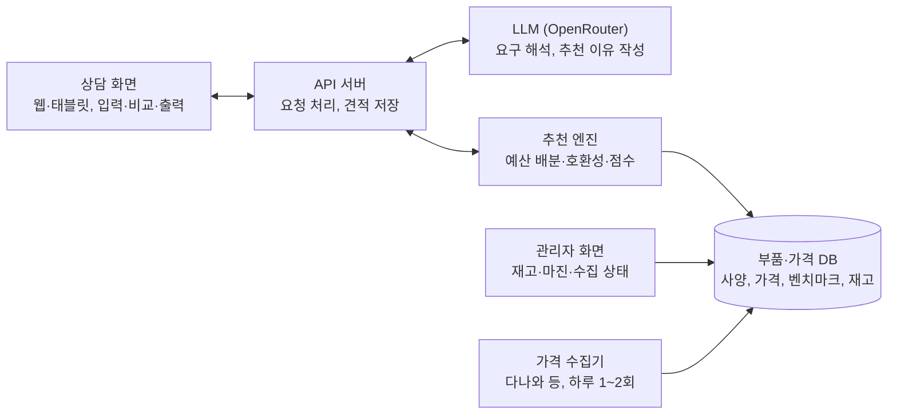

# AI PC 견적 추천 시스템 기획서

작성일: 2026-11-06

## 1. 개요

고객의 용도와 예산을 입력하면 최신 시세 기준으로 호환성이 검증된 1·2·3순위 조립 견적을 1분 안에 제시하는 시스템을 만든다.

**배경.** 수리점 조립 상담은 직원이 부품 시세를 매번 검색하고, 호환성을 머리로 확인하며, 견적서를 수작업으로 만든다. 상담 한 건이 길어지고, 직원 숙련도에 따라 견적 품질이 달라진다.

**해결할 문제.**

- 시세 변동이 잦아 어제 견적이 오늘 맞지 않는다
- 소켓·전력·크기 등 호환성 실수가 반품과 재조립으로 이어진다
- 고객은 "왜 이 부품인지" 설명을 원하지만 근거 정리에 시간이 든다

**목표.**

1. 상담 1건당 견적 작성 시간을 5분 이내로 줄인다
2. 추천 견적의 호환성 오류를 0건으로 만든다
3. 예산 대비 성능이 가장 높은 조합을 근거와 함께 설명한다

## 2. 대상 사용자와 사용 시나리오

1차 사용자는 매장 상담 직원이고, 고객은 직원 화면을 함께 보거나 출력된 견적서를 받는다.

| 사용자 | 필요한 것 | 시스템이 주는 것 |
| --- | --- | --- |
| 상담 직원 | 빠르고 틀리지 않는 견적 | 호환성 검증된 3개 안, 재고·마진 반영 |
| 고객 | 내 용도에 맞는지, 왜 이 가격인지 | 쉬운 말로 된 추천 이유, 체감 성능 설명 |
| 매장 사장(관리자) | 마진과 재고 관리 | 선호 부품·브랜드 설정, 상담 이력 통계 |

**대표 시나리오.**

1. 고객이 "배그랑 영상편집, 150만 원"이라고 말한다
2. 직원이 용도(게임·편집)와 예산(150만 원), 선택 조건(모니터 제외, 화이트 케이스)을 입력한다
3. 시스템이 1순위(균형형)·2순위(성능 우선)·3순위(가성비) 견적을 보여준다
4. 직원이 부품 하나를 바꾸면 시스템이 호환성과 총액을 즉시 다시 계산한다
5. 확정한 견적을 PDF로 출력하거나 카카오톡 링크로 보낸다

## 3. 핵심 기능 요구사항

MVP는 입력 → 3개 견적 생성 → 부품 교체·재계산 → 출력의 네 단계만 완성한다.

| 기능 | 내용 | 우선순위 |
| --- | --- | --- |
| 요구사항 입력 | 용도(복수 선택), 예산, 필수/제외 조건, 자연어 메모 | MVP |
| 자연어 해석 | "롤이랑 유튜브 편집 정도" 같은 말을 용도·성능 목표로 변환 | MVP |
| 견적 3안 생성 | 균형형·성능 우선형·가성비형, 예산 이하·가격 간격 보장 | MVP |
| 호환성 검증 | 소켓, 메모리 규격, 전력, 케이스 크기, 쿨러 높이, M.2 슬롯 | MVP |
| 추천 이유 설명 | 부품별 선택 근거와 예상 체감 성능을 쉬운 말로 | MVP |
| 부품 교체·재계산 | 한 부품 변경 시 대체 후보 제시, 총액·호환성 즉시 갱신 | MVP |
| 견적서 출력 | PDF, 공유 링크, 매장 로고·연락처 포함 | MVP |
| 재고·마진 반영 | 매장 보유 재고 우선, 부품별 마진율 설정 | 2단계 |
| 상담 이력 | 고객별 견적 저장, 재방문 시 불러오기 | 2단계 |
| 업그레이드 견적 | 기존 PC 사양 입력 시 교체할 부품만 추천 | 3단계 |

**비기능 요구사항.** 견적 3안 생성은 15초 이내, 가격 데이터는 하루 1회 이상 갱신, 태블릿 화면에서도 사용 가능해야 한다.

## 4. 추천 로직 설계

부품 선택과 가격 계산은 규칙 엔진과 최적화 알고리즘이 하고, LLM은 고객 말 해석과 추천 이유 설명만 맡는다. LLM이 부품명이나 가격을 직접 만들면 단종품·틀린 가격이 섞이기 때문이다.

**처리 단계.**

1. **요구 해석(LLM)**: 자연어 입력을 구조화된 조건으로 변환한다. 예: `{용도: [게임 QHD, 영상편집], 예산: 1500000, 제외: [모니터], 선호: [화이트]}`
2. **성능 목표 설정(규칙)**: 용도별 최소 사양을 정한다. 예: QHD 게임이면 GPU 등급 하한, 영상편집이면 RAM 32GB 이상
3. **예산 배분(규칙)**: 아래 용도별 비율로 부품군 예산을 나눈다
4. **후보 탐색(최적화)**: 부품군별 예산 범위 안에서 후보를 뽑고, 호환성을 통과하는 조합 중 점수가 높은 순으로 정렬한다
5. **3안 선정(규칙)**: 같은 점수 함수에 가중치만 바꿔 균형형·성능 우선형·가성비형을 고른다
6. **설명 생성(LLM)**: 확정된 부품 목록과 벤치마크 수치만 넘겨 고객용 설명을 쓰게 한다

**용도별 예산 배분 초기값(본체 기준, 운영하며 조정).**

| 용도 | CPU | GPU | 메인보드 | RAM | SSD | 파워·케이스·쿨러 |
| --- | --- | --- | --- | --- | --- | --- |
| 고사양 게임 | 18% | 42% | 10% | 7% | 7% | 16% |
| 영상편집·3D | 27% | 30% | 11% | 12% | 8% | 12% |
| 사무·학습 | 35% | 0% (내장) | 15% | 13% | 15% | 22% |
| AI·개발 | 20% | 45% | 9% | 11% | 6% | 9% |

**점수 함수.** 조합 점수 = 용도별 가중 성능 점수 ÷ 총액. 성능 점수는 CPU·GPU 벤치마크 정규화 값을 쓰고, 병목(CPU와 GPU 등급 차이가 큰 경우)에는 감점한다.

**호환성 규칙(필수 통과).**

- CPU 소켓 = 메인보드 소켓, 메인보드 칩셋이 CPU 세대 지원
- 메모리 규격(DDR4/DDR5)과 메인보드 일치
- 파워 용량 ≥ (CPU TDP + GPU 권장 전력) × 1.3
- GPU 길이 ≤ 케이스 최대 GPU 길이, 쿨러 높이 ≤ 케이스 허용 높이
- 메인보드 폼팩터가 케이스 지원 목록에 포함

## 5. 데이터

추천 품질은 부품 사양 DB, 가격, 성능 점수 세 가지 데이터의 정확도와 신선도가 결정한다. 가격은 정식 API가 없으므로 다나와 등 가격비교 사이트에서 자체 수집한다.

| 데이터 | 주요 항목 | 수집 방법 | 갱신 주기 |
| --- | --- | --- | --- |
| 부품 사양 | 소켓, 칩셋, 메모리 규격, TDP, 크기(길이·높이), 폼팩터, 슬롯 수 | 제조사 스펙 + 가격비교 사이트 상세 정보, 수동 검수 | 신제품 출시 시 |
| 가격 | 최저가, 평균가, 판매처 수, 품절 여부 | 가격비교 사이트 수집기 | 하루 1~2회 |
| 성능 점수 | CPU·GPU 벤치마크, 게임별 FPS 참고치 | 공개 벤치마크 정리 후 정규화 | 월 1회 |
| 매장 데이터 | 보유 재고, 매입가, 마진율, 선호 브랜드 | 관리자 화면 입력 | 수시 |

**수집 원칙.**

- 요청 간격을 두고 필요한 카테고리만 수집해 대상 사이트에 부담을 주지 않는다
- 수집 실패·급격한 가격 변동(±30% 이상)은 자동 반영하지 않고 관리자 확인 대기로 둔다
- 품절·단종 상품은 후보에서 자동 제외한다
- 대상 사이트 이용약관을 확인하고, 문제가 되면 매장 거래 도매처 가격표 입력 방식으로 대체한다

## 6. 시스템 아키텍처와 기술 스택

웹 화면, API 서버, 추천 엔진, 부품·가격 DB, 가격 수집기, LLM 연동, 관리자 화면의 7개 모듈로 구성하고, 추천 엔진이 DB 값만으로 견적을 확정한다.

API 서버는 LLM에 입력 해석과 설명 작성만 요청하고, 부품 조합은 추천 엔진이 DB를 읽어 계산한다.

| 영역 | 선택 | 이유 |
| --- | --- | --- |
| 프론트엔드 | Next.js (React) | 웹·태블릿 반응형, 견적서 화면 재사용 |
| 백엔드 | Python FastAPI | 최적화·데이터 처리 라이브러리 활용 |
| 추천 엔진 | Python, 조합 탐색 + 규칙 검사 | 부품군별 후보를 좁힌 뒤 조합 평가 |
| DB | PostgreSQL | 부품 사양 관계형 관리, 가격 이력 저장 |
| 가격 수집기 | Playwright + 스케줄러 | 동적 페이지 대응, 정해진 시각 실행 |
| LLM | OpenRouter | 모델 교체 쉬움, 해석용·설명용 모델 분리 |
| 견적서 | HTML → PDF 서버 렌더링 | 매장 양식 그대로 출력 |

## 7. 리스크와 성공 지표

가장 큰 리스크는 가격 수집 중단과 부품 사양 데이터 오류이며, 둘 다 사람이 확인하는 단계를 둬서 막는다.

| 리스크 | 영향 | 대응 |
| --- | --- | --- |
| 가격 사이트 구조 변경·차단 | 가격 갱신 중단 | 수집 실패 알림, 마지막 가격 표시와 기준 시각 명시, 도매처 가격표 업로드로 대체 |
| 부품 사양 오류 | 호환성 오판 | 신규 부품 수동 검수, 조립 후 직원 피드백으로 오류 수정 |
| LLM 오답·환각 | 없는 부품이나 틀린 수치 설명 | 부품·가격은 DB 값만 사용, 설명 문장 속 수치를 DB와 대조 |
| LLM 비용·지연 | 상담 대기 | OpenRouter에서 해석용은 저가 모델, 설명용은 상위 모델로 분리, 결과 캐시 |
| 이용약관 문제 | 수집 중단 요구 | 사전 약관 검토, 수집 범위 최소화 |

**성공 지표.**

- 견적 작성 시간: 상담 1건당 5분 이내
- 호환성 오류: 출고 기준 0건
- 1순위 채택률: 고객이 1~3순위 중 하나를 수정 없이 또는 부품 1개 이내 수정으로 채택한 비율 70% 이상
- 가격 정확도: 견적 시점 가격과 실제 매입가 차이 ±3% 이내
