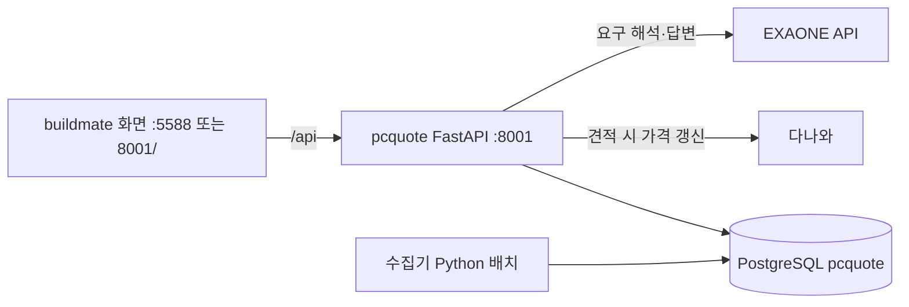

# 구현 구조와 기획서 대비 결정

기획서: [plan.md](plan.md)

## 구성

2026-11-06부터 이 서버가 Dr.Robot의 유일한 서버다. 화면은 buildmate React 앱(`../buildmate/src`)이다. 2026-11-07부터 수집도 이 프로젝트의 수집기가 한다(LaunchAgent `com.drrobot.daily-components`가 매일 0시 `backend/scripts/run_collector_daily.sh` 실행).

| 경로 | 역할 |
| --- | --- |
| `backend/src/pcquote/main.py` | FastAPI. 화면 API(응답 `{error}` 형식 유지)와 엔진 API. `../buildmate/dist`가 있으면 `/`에서 화면 제공 |
| `backend/src/pcquote/service.py` | 카탈로그 상태: PostgreSQL → 화면용 스냅샷 + 엔진 `Catalog`를 5분 캐시. 가격 갱신 반영(±30% 변동은 `price_reviews`로 보류) |
| `backend/src/pcquote/screen.py` | 화면 형식 변환: requirement → 엔진 요청, 3안 → 화면 견적, 가격 갱신 후 재추천(최대 6회), 교체 검사, 견적 저장 검증 |
| `backend/src/pcquote/policy.py` | 매장 데이터 정책(필수 사양, NVMe 전용, 가격 24시간, 벤치마크 3표본·45일). buildmate JS와 판정 일치 확인 |
| `backend/src/pcquote/consult.py` | 요구 문장 규칙(용도·예산(한글 숫자 포함)·해상도·모델명), 고객 선호(모델·브랜드·용량) 추출, 카탈로그 기반 답변. buildmate JS와 결과 일치 확인 |
| `backend/src/pcquote/llm.py` | EXAONE/OpenRouter 호출, 요구 해석, 근거 기반 답변과 출력 검사(근거 밖 금액·FPS 수치) |
| `backend/src/pcquote/danawa.py` | 다나와 상품 페이지 JSON-LD 가격 수집(robots.txt, 출처당 2초, 허용 호스트, 재시도, 8MB) |
| `backend/src/pcquote/importer.py` | 발행 카탈로그(documents.db `public/data/catalog.json`) → PostgreSQL. updated_at이 바뀌면 자동, 더 최신 가격은 보존, 빠진 부품은 숨김 |
| `backend/src/pcquote/pipeline.py` | 수집 현황 문서 읽기, 수동 수집(`node pipeline/run.mjs --expand`) 실행 |
| `backend/src/pcquote/catalog.py` | 엔진용 부품 모델(`Part`, `Catalog`), 필수 사양, 벤치마크 정규화(부품군 최고 = 100) |
| `backend/src/pcquote/engine/requirements.py` | 용도별 예산 배분 비율, 최소 사양, 성능 가중치 |
| `backend/src/pcquote/engine/chipset.py` | 칩셋 ↔ CPU 세대 지원 규칙 |
| `backend/src/pcquote/engine/compatibility.py` | 호환성 규칙. 탐색과 견적 재계산이 같은 코드를 사용 |
| `backend/src/pcquote/engine/recommend.py` | 후보 탐색, 3안 선정, 재계산·대체 후보 |
| `backend/src/pcquote/db.py` | PostgreSQL 스키마: `parts`(엔진 사양 + 화면용 원본 `raw`), `price_history`, `saved_quotes`, `app_settings`, `documents`, `llm_usage`, `price_reviews` |
| `backend/scripts/seed_from_buildmate.py` | 카탈로그 강제 가져오기(파일 지정 가능) |
| `backend/scripts/migrate_buildmate_db.py` | buildmate.db 운영 데이터(견적·설정·상담 상태·LLM 사용량) 이전. 재실행해도 중복 없음 |
| `backend/scripts/llm_eval.py` | 대표 질문 7개로 LLM 답변 평가 |
| `backend/data/buildmate-reparsed-specs.json` | buildmate 수정 파서로 원문 캐시를 재파싱해 얻은 누락 사양(369개 부품). 스냅샷 값이 없을 때만 채움. `scripts/reparse_buildmate_specs.mjs`로 재생성 |

### 수집기 `backend/src/pcquote/collector/` (2026-11-07 전환)

buildmate Node 수집 파이프라인(`pipeline/`)을 옮긴 것이다. 수집 규칙과 결과는 같고, 저장소는 PostgreSQL이다.

| 경로 | 역할 |
| --- | --- |
| `collector/parse.py`, `jsre.py` | 다나와 상품(JSON-LD 사양·가격·등록월)·검색·카테고리·인기 순위 파서, 벤치마크 이름, 신제품 판정. JS 정규식 의미(`\d` ASCII, JS 공백)를 맞춘다 |
| `collector/client.py` | 수집 클라이언트: 허용 호스트, robots.txt(와일드카드·가장 긴 규칙·Crawl-delay), 출처당 2초, 리디렉션 금지, 재시도, 8MB, ETag/Last-Modified 조건부 요청 |
| `collector/store.py` | `product_facts`, `price_observations`, `benchmark_observations`, `review_queue`, `collector_jobs`, `source_cache`(zlib) 테이블과 `collector/*` 문서. 30% 가격 변동 검수. PostgreSQL advisory lock |
| `collector/expand.py` | 카테고리·검색 페이지로 신제품 발견(진행 저장·재개), 인기 순위 갱신 |
| `collector/blender.py` | Blender Open Data ZIP(7일 캐시) 스트리밍 집계, 버전별 선택 |
| `collector/run.py` | 가격·사양 수집 → 벤치마크 → 스냅샷 → 발행. 소유자가 수집기면 `parts`로 가져오고, 아니면 `collector/catalog-shadow`에 둔다 |
| `collector/daily.py` | 한국시간 하루 한 번 실행과 `collector/daily-YYYY-MM-DD` 보고서 |
| `collector/bootstrap.py`, `shadow.py` | Node 상태 가져오기, Node 원문 캐시 재생(네트워크 없음) 후 카탈로그 비교 |
| `collector/__main__.py` | `python -m pcquote.collector run/daily/expand/publish/discover/bootstrap/shadow/cutover` |

전환(`cutover`)은 `catalog-owner` 문서를 `collector`로 바꾼다. 그 뒤 서버는 buildmate documents.db를 읽지 않고, 수집 현황은 `collector/*` 문서에서 읽으며, 수동 수집은 Python 수집기를 실행한다. 견적 시 가격 갱신(`danawa.py`)도 수집기의 클라이언트·파서를 쓰고, 받아들인 가격을 `price_observations`에, 30% 변동을 `review_queue`에도 남긴다. 일일 실행은 `backend/scripts/run_collector_daily.sh`.

엔진은 DB를 직접 읽지 않는다. 서비스가 `Catalog`를 넘기므로 엔진 테스트는 DB 없이 돈다. 엔진 `Part.quotable`은 데이터 정책을 가격 시각만 빼고 적용한 결과다. 만료 가격은 빼지 않고 견적 때 갱신한다.

## API

화면 API(buildmate 화면이 쓰는 형식):

| 메서드·경로 | 내용 |
| --- | --- |
| `GET /api/health` | `{ok, mode: live, llm, storage: postgresql, engine: pcquote}` |
| `GET /api/catalog` | 화면 형식 카탈로그(메타 + 원본 부품, 가상 옵션 포함) |
| `GET /api/pipeline/status`, `/api/discovery/status`, `/api/prices/snapshot` | 수집 문서(documents.db) |
| `POST /api/pipeline/run` | 수동 수집 실행(실행 중이면 409) |
| `POST /api/requirements` | 요구 해석(LLM, 없으면 규칙) |
| `POST /api/answer` | 근거 기반 질문 답변 |
| `POST /api/recommend/fresh` | `{requirement, settings}` → 화면 견적 3안 + 가격 갱신 결과 |
| `POST /api/quotes/evaluate` | `{requirement, settings, parts}` → 화면 형식 검사·성능·경고 |
| `POST /api/quotes/alternatives` | 호환 대체 후보(인기순 → 가격 차이 작은 순, 최대 2000) |
| `GET/POST /api/quotes`, `DELETE /api/quotes/{id}`, `POST /api/quotes/import` | 확정 견적 이력. 저장 시 부품·정책·가격·버전·호환·예산 +5%를 재검증 |
| `GET/PUT /api/settings`, `GET/PUT /api/state/{name}` | 매장 설정, 테마·진행 중 상담 |

엔진 API:

| 메서드·경로 | 내용 |
| --- | --- |
| `POST /api/recommend` | 엔진 결과 그대로(가격 갱신 없음, 진단용). `excludeParts`로 부품 제외 |
| `GET /api/options`, `GET /api/catalog/summary` | 선택지, 부품군별 전체·사용 가능 수 |
| `POST /api/admin/catalog/reload` | 발행 카탈로그 강제 가져오기 + 캐시 갱신 |

## 탐색 방식

1. 사용 가능한 부품: 재고 있음, 가격 > 0, 필수 사양 있음. CPU·GPU는 실측 벤치마크(표본 3개 이상)가 있어야 한다.
2. 부품군마다 배분액 ±50%와 ±100% 범위를 모두 탐색한다. 같은 칩·같은 관련 사양 묶음에서는 최저가 제품과 최인기 제품을 남긴다.
3. CPU×GPU 쌍마다 나머지 부품을 세 가지로 구성한다.
   - 최저가: 부품마다 가장 싼 호환 제품
   - 인기: 부품마다 가장 인기 있는 호환 제품
   - 예산 내 인기: 최저가 구성에서 시작해 예산 상한 안에서 인기품으로 교체한다. 원당 인기 상승이 큰 부품부터 바꾼다.
   나머지 부품은 독립 하위 문제로 나눠 메모한다: 파워, 보드 목록, 보드별 램·SSD, 케이스+쿨러.
4. 총액이 예산의 55~100%인 조합에서 3안을 고른다(성능 우선형은 균형형×1.12 이상, 가성비형은 ×0.85 이하, 부족하면 간격을 줄임). 서로 다른 CPU·GPU 조합이 3개 미만이면 ±200% → 제한 없음 순으로 넓히고, 넓힌 사실을 안내문에 남긴다.
5. 점수(아래 "인기도") 순으로, 1순위 균형형 → 2순위 성능 우선형 → 3순위 가성비형 차례로 고른다. 뒤 순위는 앞 순위가 가져간 CPU·GPU 쌍을 뺀 나머지에서 고른다.
5-1. 기본 최소 사양으로 조합이 없으면 메모리 32→16GB → SSD 1TB→500GB → 게임 그래픽카드 기준 한 해상도 아래 → (기준이 FHD RTX 4060급이 되면) RTX 5050급 → RTX 3050급 순으로 낮춰 다시 찾는다. 사무용은 메모리 16→8GB → SSD 500→256GB까지 낮춘다(`relaxed_specs`). AI VRAM과 고객이 직접 말한 하한은 낮추지 않는다. 낮춘 내용은 `Result.relaxed`, 화면 응답 `notice`.
5-2. 고객 선호(요청 문장의 CPU·GPU 모델, 인텔·AMD CPU, 지포스·라데온 GPU, 메모리·SSD·VRAM 하한)는 `screen.to_request`가 `consult.customer_preferences`로 읽어 `Request`에 넣는다. 조합이 있는 동안은 필수 조건이고, 없으면 선호를 빼고 다시 찾아 이유를 `Result.dropped`·`notice`로 알린다. 모델 토큰은 카탈로그로 CPU·GPU를 가린다.
6. 예산 55~100% 안 조합이 없으면 더 저렴한 조합을 제시한다. 그것도 없으면 이 조건의 최저 가능 금액을 안내한다.

플랫폼을 정하는 부품(메모리는 DDR 종류별, 보드는 소켓·DDR 조합별)은 배분 범위와 상관없이 가장 싼 제품과 가장 인기 있는 제품을 항상 후보에 넣는다(`platform_anchors`). 고정 비율이 시세를 따라가지 못하면(2026-11 DDR5 32GB 566,100원 이상) DDR5 전용 플랫폼(AM5·LGA1851) 전체가 점수 계산 전에 빠지기 때문이다.

## 인기도

인기가 많은 제품은 이미 구매자에게 검증됐다고 보고, 모든 안에서 인기도에 가장 큰 비중을 둔다(2026-11-06 결정). 호환성, 최소 사양, 예산 상한은 인기도와 상관없이 지킨다.

- 부품 점수: 다나와 카테고리 "인기상품순" 순위(1~30위)로 매긴다. 1위 = 1.0, 30위 = 1/30, 순위 밖 = 0이다. 수집한 지 14일이 지난 순위는 쓰지 않는다.
- 조합 점수: 부품 점수의 가중 평균이다. CPU·GPU 각 20%, 보드 15%, 램·SSD·파워·케이스 각 10%, 쿨러 5%이고, 외장 GPU가 없으면 나머지로 다시 나눈다.
- 안 점수 = (인기 × a + 성능/최고성능 × b + 가성비/최고가성비 × c) × 병목계수^d

| 안 | 인기 a | 성능 b | 가성비 c | 병목 d |
| --- | --- | --- | --- | --- |
| 균형형 | 0.60 | 0.20 | 0.20 | 2 |
| 성능 우선형 | 0.60 | 0.29 | 0.11 | 1 |
| 가성비형 | 0.60 | 0.11 | 0.29 | 1 |

2026-11-07 매장 결정으로 인기 비중을 0.50/0.45에서 0.60으로 올렸다(성능·가성비는 원래 비율대로 축소). 그 전에는 250만 원 QHD 게임 견적에서 인기 0.95인 AM5 조합이 DDR5 추가 비용만큼 GPU가 낮아져 인기 0.85인 DDR4 조합에 0.800 대 0.804로 졌다.

- 세 안의 순서(2026-11-07 요청자 지시 "성능강화안이 가장 비싸고 강력한 성능이어야 해"): 성능 우선형은 균형형보다 성능이 높고 가격이 같거나 높아야 하고, 가성비형은 균형형보다 싸고 성능 우선형보다 빠르지 않아야 한다. 균형형은 점수순으로 보되, 이 순서를 지키는 두 안을 함께 만들 수 있는 첫 조합을 고른다(`_pick_plans`). 배분 범위 탐색도 순서가 맞는 3안이 나올 때까지 넓힌다. 끝까지 없으면 해당 안을 생략하고 알림에 이유를 남긴다. 성능은 CPU·GPU Blender 점수 기반이라 게임 FPS 순서와 다를 수 있다.
- 대체 후보 목록도 인기 순위가 있는 제품을 먼저, 그다음 가격 차이가 작은 순으로 보여 준다.
- 절충: 인기 1순위 조합이 더 느리면서 더 비쌀 수 있다. 예(2026-11-07 실제 카탈로그): QHD 250만 원 3안이 모두 AM5 + B850M 박격포 + DDR5 + RTX 5060 Ti다. 비중을 올리기 전 1순위는 라이젠 5 5600 + DDR4 + RTX 5070이었다.

## 기획서와 다르게 구현한 부분

| 항목 | 기획서 | 구현 | 이유 |
| --- | --- | --- | --- |
| 파워 등급 | 없음 | 외장 GPU 조합에는 80PLUS 등급(efficiency)이 있는 파워만 | 2026-11-07 시나리오 평가에서 등급 없는 16,000원 벌크 600W가 RTX 5060 Ti 견적 45곳에 들어감 |
| 파워 용량 | (CPU TDP + GPU) × 1.3 | (CPU 최대 전력 + GPU) × 1.3, GPU 제조사 최소 파워도 함께 적용 | 인텔 K 모델은 TDP 125W, 최대 253W다. TDP 기준이면 파워가 부족할 수 있다 |
| 칩셋 세대 지원 | 지원 여부 | 지원 / BIOS 업데이트 후 지원(경고 표시) / 미지원 | 출시 전 보드는 신세대 CPU에 BIOS 업데이트가 필요하다. 경고 조합은 추천하되 견적에 표시한다 |
| 지원 플랫폼 | 명시 없음 | LGA1700(600·700), LGA1851(800), AM5(600·800), AM4(400·500)만 | 그 외 구형 칩셋은 신규 조립 대상에서 제외 |
| 전원부 등급 | 없음 | H610·H810·A520·A620 보드에는 CPU 최대 전력 160W 이하만 | 엔트리 보드 전원부에 i7 K급을 얹는 조합을 막는 매장 정책 |
| 수랭 쿨러 | 쿨러 높이 | 자동 추천 제외 | 라디에이터 장착 위치 데이터가 없다 |
| 저장장치 | 용량 | NVMe로 확인된 내부 드라이브만 사용(SATA·인터페이스 미확인·액세서리·캐시 모듈·U.2 제외) | buildmate 매장 정책(2026-11-06 사용자 지시) 유지. `policy.py`가 같은 규칙을 적용하고, 가져오기 때 `interface` 사양을 채운다 |
| 예산 상한 | 예산 이하 | 화면 견적·저장 모두 명시 예산 상한(2026-11-07 변경, 이전 +5%). 미지정은 budget=null 무상한(2026-11-08) | 무상한은 배분 범위 없이 호환 후보 탐색 |
| 가격 갱신 | 수집기 일괄 | 견적 때 선택된 부품 중 24시간 지난 가격만 다나와에서 다시 수집. 직전 대비 30% 넘게 바뀌면 보류 | buildmate 기존 동작 유지 |
| 해상도별 GPU 하한 | "GPU 등급 하한" | FHD RTX 4060급, QHD RTX 5060 Ti급, 4K RTX 5070 Ti급(카탈로그 벤치마크 기준). 예산이 모자라면 5-1 순서로 낮춤 | 설명 가능한 기준 칩으로 정함. 2026-11 RTX 4060 최저가가 97만 원대라 100만 원 FHD 게임 견적이 불가능했음 |
| 파워·케이스·쿨러 비율 | 합계만 | 파워 45%, 케이스 35%, 쿨러 20%로 나눔 | 부품군별 범위 제한에 필요 |
| 복수 용도 | 복수 선택 | 배분 비율·성능 가중치는 평균, 최소 사양은 가장 높은 값 | |
| 예산 | 본체 기준 | 조립비를 뺀 금액을 부품 예산으로 배분. 상한은 조립비 포함 총액 기준 | |

## 알려진 한계

- 벤치마크는 Blender 지수다. AMD Radeon GPU는 점수가 없어 후보에서 빠진다. 게임 FPS 실측이 아니다.
- 카탈로그는 수집기가 매일 0시 발행한다. 서버는 견적 때 선택 부품 가격만 갱신한다.
- 견적 생성 시간은 갱신할 가격 수에 따라 늘어난다(출처당 2초 간격). 실측: 가격 8건 갱신 시 15.9초, 갱신 없을 때 0.4~9초.
- 2026-11 스냅샷은 DDR5 16GB 최저가가 약 28만 원, DDR4는 약 13만 원이다. 그래서 같은 예산에서 DDR4를 쓸 수 있는 LGA1700 조합이 많이 뽑힌다.
- 인기 순위는 부품군마다 상위 30개 제품군에만 있다(전체 6,829개 중 366개). 순위 밖 제품은 모두 0점이라 서로 구분되지 않는다. 화이트 부품은 순위가 있는 제품이 적다. 순위는 4단계 수집기가 갱신하기 전까지 2026-11-05 수집값을 쓰고, 2026-11-19에 만료된다.
- 세 안이 같은 GPU·보드를 공유하고 CPU만 다른 경우가 많다. 안끼리 더 크게 달라지게 할지는 운영하면서 정한다.

## 2026-11-08 무상한 견적과 LLM 평가

`Request.budget`·`RecommendIn.budget`은 int 또는 None이다. None이면 allocation은 0(배분 예산 없음), `_search`의 배분 범위와 총액 상한을 없애고 기본 최소 사양·호환·후보 축약 정책은 유지한다. `_recommend`는 후보 내 성능 최고안을 보존하면서 가격/성능 순서에 맞는 균형·절약 대안을 고른다. 조건에 맞는 대안이 없으면 해당 안은 생략한다. 실제 게임 성능이나 전역 최적성 보장은 아니다.

화면의 `budgetCap=null`, 평가의 `budgetDelta=null`·`withinBand=true`를 사용한다. `screen.validate_issue`는 무상한이어도 부품 등록·가격·스냅샷·호환성을 검증하며 유한 예산에만 총액 상한을 검사한다. 저장 구조 변경은 없다.

LLM 호출은 기존 `main` startup의 무료 primary/fallback 모델 설정을 기본으로 유지한다. `llm.interpret`가 2회 실패하면 method=local과 fallback 사유를 반환한다. 시나리오 평가 도구는 `--local` 없이 실행해야 실제 호출하며, 각 결과의 `requirement.interpretationSteps`에 각 턴의 실제 method/fallback을 보존한다.

- 2026-11-11: Dr.Robot 루트 Git 저장소 하나로 통합. 루트 아래 buildmate/와 pcquote/를 함께 추적하고 기존 형제 경로를 유지한다. 루트 npm setup/dev/server/build/test/test:backend 명령 제공.
